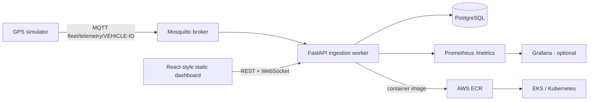

# FleetTrack — Real-Time Vehicle Tracking & DevOps Lab

A learning-grade fleet tracking platform with GPS simulation, MQTT ingestion, FastAPI REST/WebSocket APIs, PostgreSQL persistence, a live browser map, Docker Compose, CI, Kubernetes examples, Terraform starter, and Prometheus metrics.

> This is a working starter, not a certified production telematics product. Real trackers often use vendor-specific TCP/binary protocols, device authentication, clock correction, buffering, and replay protection. Integrate those after confirming the tracker protocol.

## Architecture

## Prerequisites
- Docker Desktop with Compose, Git, and a browser.
- Optional later: AWS CLI, Terraform, kubectl, Helm.

## Quick start
1. Copy `.env.example` to `.env`; change passwords before sharing/deploying.
2. Start everything: `docker compose up --build -d`
3. Check health: `curl http://localhost:8000/health`
4. Open dashboard: `http://localhost:8080`
5. API docs: `http://localhost:8000/docs`
6. Start simulated vehicles: `docker compose --profile simulator up -d simulator`
7. Watch MQTT messages: `docker compose exec mqtt mosquitto_sub -h localhost -t 'fleet/telemetry/#' -v`
8. Stop: `docker compose down`; preserve database by default. To delete local DB data: `docker compose down -v`.

Default demo login is not required; this starter intentionally has no user authentication. Do not expose it publicly until authentication, authorization, TLS, secrets management, rate limits, and audit logging are implemented.

## Useful API routes
- `GET /health` — liveness
- `GET /api/vehicles` — known vehicles and latest positions
- `GET /api/vehicles/{vehicle_id}/telemetry?limit=100` — recent history
- `POST /api/telemetry` — authenticated only in a future hardening step; currently demo ingestion endpoint
- `GET /api/alerts` — recent overspeed alerts
- `WS /ws/live` — latest telemetry broadcast
- `GET /metrics` — Prometheus metrics

## Development workflow
1. Create a Git repository and push this project.
2. Run `docker compose up --build` locally.
3. Test API with `curl` or Swagger `/docs`.
4. Run tests: `docker compose exec api pytest -q` (or install requirements locally).
5. Commit changes; GitHub Actions runs tests and builds the API image.
6. Add a container registry and deployment credentials using GitHub Actions secrets/OIDC.
7. Provision AWS using reviewed Terraform; deploy to EKS only after security review.

## Data model
`vehicles` stores identity and latest known state. `telemetry` is append-only position history. `alerts` stores generated operational events. Timestamps are UTC.

## Real GPS device integration
- Confirm device model, packet protocol, APN/SIM settings, server host/port, TLS support, and vendor packet documentation.
- If the tracker publishes MQTT, configure a unique device credential and topic ACL, then map its payload to the telemetry schema.
- If it uses TCP or a binary protocol, implement a separate protocol adapter; do not assume MQTT is supported by the device.
- Validate coordinates, timestamp freshness, speed bounds, device identity and duplicate packets.

## Production hardening checklist
- [ ] OIDC/JWT authentication and role-based authorization
- [ ] MQTT TLS, per-device credentials, topic ACLs and credential rotation
- [ ] TLS ingress, private database subnet, secret manager, least-privilege IAM
- [ ] Database migrations, backups, restore drills and retention/partitioning
- [ ] Rate limits, schema validation, idempotency and replay protection
- [ ] Alert delivery integrations and configurable geofence rules
- [ ] Load tests, SLOs, dashboards, on-call alerts and incident runbooks
- [ ] Privacy policy, consent, data retention and access audit for location data
